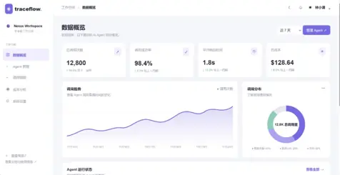
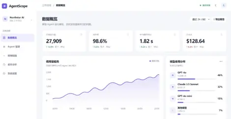

# Agent dashboard — exploratory A/B example

[简体中文](README.zh-CN.md) · [Back to Always UI](../../README.md)

Two desktop web dashboards generated during the same Always UI evaluation conversation. The first was created **without** the skill and the second **with** the skill. These are **visual samples**, not a controlled experiment.

| A — without Always UI | B — with Always UI |
| --- | --- |
|  |  |
| **Traceflow** | **AgentScope** |

## What changed in the screenshots

| Area | A — without | B — with | Reading |
| --- | --- | --- | --- |
| Color emphasis | Purple appears in the primary management button, KPI decorations, active navigation and chart | Purple remains in the brand, active navigation, data accents and chart, while the top actions look quieter | **Subjective improvement in visual restraint**; both designs still use purple |
| Buttons | The prominent “Manage Agent” button occupies the top-right action area | A more subdued date selector and “Export report” action occupy the same area | **Different actions and priorities**; visual restraint is apparent, but CTA superiority cannot be isolated |
| Data breakdown | A donut labeled “Call Distribution” | A model-by-model usage breakdown with labels, bars and percentages | The latter is easier to scan **for per-model comparison**; the metrics are **not equivalent** |
| Hierarchy | Four KPI cards above a trend chart and donut | Four KPI cards above a trend chart and model breakdown | Both use nearly the same dashboard skeleton; the skill did **not** demonstrate a novel layout here |
| Decoration | Some brighter action accents and decorative KPI icons | More subdued KPI detail icons and controls | Suggests less competing emphasis, but not a measured style difference |

### What the skill appears to have helped

The B screenshot looks more restrained around action buttons and metadata. More of the visual weight stays on the KPI numbers, trend chart and model breakdown rather than the surrounding controls.

This is **consistent with** the skill's principles—[color restraint, button hierarchy, decoration justification and component economy](../../references/visual-discipline.md)—but one pair of generated screenshots cannot establish that the skill caused the differences.

### What still needs work

- **Template risk:** both versions use a familiar left sidebar, four KPI cards and lower chart/content grid. A quieter design is not automatically a more original one.
- **Brand character:** the B screenshot remains a conventional light SaaS dashboard, with limited distinctive identity.
- **Typography:** some supporting labels and chart text look faint at the supplied screenshot resolution. Actual contrast and legibility remain unmeasured.
- **Interaction quality:** no evidence here about click paths, keyboard focus, loading/error states, chart accessibility, responsiveness or real behavior.

## Study notes and limitations

- **Source:** two screenshots shared by the project owner in the same chat on **2026-11-20**; visual order is **before / after**. The checked-in WebP images are display-size copies (approximately half-resolution) of those screenshots; no design elements were intentionally changed.
- **Reported condition:** A = generated without Always UI; B = generated with Always UI.
- **Not independently verified:** exact model/version, prompt parity, source code, run settings, seed, installed Skill version, tool environment and whether the agent read each Skill reference.
- **Important confounders:** branding and content differ (**Traceflow** vs **AgentScope**). A shows **last 7 days** and 12,800 calls; B shows **last 24 hours** and 27,909 calls. Their secondary charts do not describe the same breakdown. This means a causal score or precise "improvement percentage" would be unjustified.
- **Evidence available:** static visual screenshots only. No working prototype, code audit or user study was supplied.
- **Assessment type:** qualitative, exploratory, one sample per condition. No numeric effectiveness or accessibility score is claimed.

## How to reproduce more rigorously

1. Freeze a product brief, brand, metrics, chart data, copy, target viewport, asset set and initial code.
2. Run the **same model and settings** in two clean sessions: A without the skill, B with `$always-ui design`. Capture the Skill reference reads if the host exposes them.
3. Compare the same pages/states and inspect generated source. Treat the product content separately from the UI shell.
4. Score blind, by multiple reviewers if possible, on layout-task fit, hierarchy, useful component choice, visual noise, originality, and real interaction behavior.
5. Run `$always-ui check` on a **shared intentionally flawed artifact** to evaluate defect detection and false positives independently of generation quality.
6. Publish the prompts, assets, code revisions, screenshots and evaluation rubric with the next run.

## Takeaway

In this one visual comparison, the skill-on result looks **more restrained and easier to scan in parts**, while remaining structurally conventional. The evidence supports a **promising qualitative signal**, not a measured claim of better overall design quality.

This case is deliberately kept separate from the Skill's normative rules: a single aesthetically pleasing result should never become a universal template.
