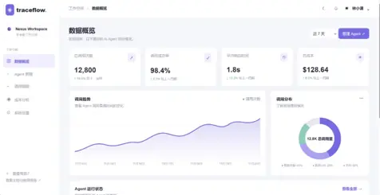
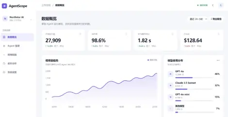

# Agent 数据看板 · 第一轮 A/B 视觉对照

[English](README.md) · [返回 Always UI](../../README.zh-CN.md)

两张截图来自同一次 Always UI 评估交流。**A 组未使用 Skill，B 组使用了 Skill**。这是一次**探索性的视觉对照**，而不是变量完全受控、能够证明因果关系的实验。

| A：未使用 Always UI | B：使用 Always UI |
| --- | --- |
|  |  |
| **Traceflow** | **AgentScope** |

## 从截图能够观察到什么？

| 方面 | A 组 | B 组 | 初步判断 |
| --- | --- | --- | --- |
| 颜色使用 | 紫色出现在管理按钮、KPI 装饰、选中导航及图表中 | 保留紫色主题，但顶部工具按钮更克制 | **视觉强调有所收敛**；两组仍然使用紫色 |
| 按钮层级 | 顶部显眼的「管理 Agent」主按钮 | 顶部的时间范围与「导出报告」强调较弱 | 视觉更克制，但**操作本身不同**，不能直接断言操作层级更正确 |
| 数据呈现 | 「调用分布」环图 | 按模型列出的使用分布、次数和百分比 | 后者**更便于逐项比较模型**；但两图表达的指标不是同一维度 |
| 布局 | 四个 KPI + 趋势图 + 环图；左侧导航 | 四个 KPI + 趋势图 + 模型分布；左侧导航 | **整体结构接近**，并没有证明 Skill 创造了新的布局范式 |
| 装饰 | 操作按钮与 KPI 的视觉强调较多 | KPI 图标及工具按钮相对平静 | 看上去减少了部分视觉竞争，但未做量化测量 |

### 初步有效的方向

B 组更集中地突出 KPI 数值、趋势图和模型分布，控件本身相对不那么抢眼。这与 Always UI 的 [Color Restraint、Button Hierarchy、Decoration Justification、Component Economy](../../references/visual-discipline.md) 方向一致。

不过，**一致不等于已经证明由 Skill 导致**。这组样本只能作为探索阶段的视觉反馈。

### 仍然存在的问题

- **模板化风险：** 两组都采用左侧导航、四张 KPI 卡片、下方图表区域，B 组更整洁，但仍然是常见 SaaS 看板结构。
- **产品辨识度：** B 组更像成熟后台，却没有展示特别鲜明的品牌个性。
- **辅助文字：** 部分图表标签、说明文字在截图尺寸下比较淡；真实对比度和可读性尚未测量。
- **交互不可知：** 仅凭静态截图无法评估按钮能否工作、键盘焦点、加载/失败反馈、响应式或可访问性。

## 测试条件与局限

- **素材：** 用户在 **2026-11-20** 提供的两张截图，依照发图顺序记录为 Before / After。仓库内的 WebP 是约半分辨率的展示副本，没有有意更改界面元素。
- **使用条件：** 根据用户说明，A 未加载 Always UI、B 加载了 Always UI。
- **未独立核实：** Gemini 的具体版本、两组提示词是否逐字一致、模型设置/随机性、源码状态、Skill 版本、实际加载了哪些参考文件。
- **混杂变量：** 产品名不同（**Traceflow** / **AgentScope**）；A 显示**近 7 天**、调用量 **12,800**，B 显示**最近 24 小时**、调用量 **27,909**；右侧图表也不是同一指标。因此不能据此计算客观提升百分比。
- **证据范围：** 只有静态截图，没有完整代码、可运行演示、用户测试或无障碍检测。
- **性质：** 单次、每组一个样本、主观视觉观察；**不记录虚构的精确效果分数**。

## 下一轮如何测得更可靠？

1. 固定同一份产品需求、品牌、数据、图表、文本、素材、视口及初始代码。
2. 使用相同模型、思考等级和工具权限，分别运行未加载 Skill 的 A 组和 `$always-ui design` 的 B 组；如环境允许，记录实际参考文档读取情况。
3. 对同一页面和同一状态截图，审核源码与真实交互，将「客户展示的内容」与「软件界面本身」分开评价。
4. 由多名评审者尽量盲评：布局适配、信息层级、组件选择、视觉噪声、原创性和交互行为。
5. 另取同一个**故意存在缺陷**的页面，用 `$always-ui check` 测试问题发现率与误判率。
6. 下一轮公开提示词、代码版本、截图、原始样本及评分标准。

## 阶段性结论

这组截图显示，使用 Always UI 的版本在**控件视觉克制和局部信息可扫描性**方面呈现了积极变化，但整体布局仍偏常见模板。

**这是一条值得继续验证的定性信号，而不是已经证明 Skill 能带来多少百分比提升。**

我们希望 Always UI 帮助 Agent 作出更好的设计判断，而不是让所有产品最终都长成这一张看板。
